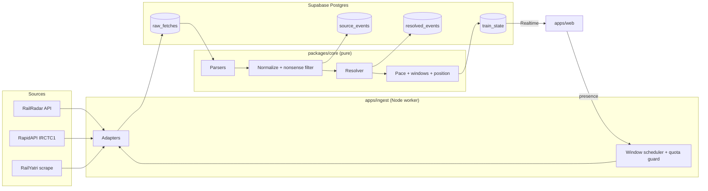

# Architecture

How the pieces fit. Read PRODUCT.md first for what we are building and DATA_SOURCES.md for where data comes from and when we check it.

## Data flow



One check for one journey:

1. The scheduler sees that a watched journey's arrival window is open, or it is running late.
2. The adapter fetches. The raw response is saved to `raw_fetches` whatever happens next.
3. Parse, normalize, filter nonsense. Survivors go to `source_events`.
4. The resolver re-runs over all of the journey's events and rewrites `resolved_events`.
5. Pace, windows and position are computed and written to `train_state`.
6. Supabase Realtime pushes the new `train_state` to every open browser.

Steps 3 to 5 are one function call in `packages/core`. They finish in milliseconds. The browser gets data, pace and windows in a single update.

Between checks, the browser runs the same `packages/core` estimator every second, so the train glides. The server's `train_state` replaces the browser's version on every check.

The web app joins a Supabase Realtime presence channel per open journey. The scheduler reads presence to know which journeys anyone is watching.

## Repo layout

```
train-tracker/
├── apps/
│   ├── ingest/            Node worker. All network and database I/O lives here.
│   │   └── src/
│   │       ├── adapters/  One file per source. Fetch only.
│   │       ├── scheduler/ Window scheduler, watcher gating, quota guard, backoff, failover.
│   │       ├── jobs/      Scoring, learned caps and retention, after a journey ends.
│   │       ├── db/        Queries. No SQL anywhere else.
│   │       ├── preflight.ts  Pre-demo checks.
│   │       └── main.ts
│   └── web/               React + Vite + MapLibre + deck.gl.
│       ├── public/models/ train.glb (Kenney Train Kit, repainted)
│       └── src/
│           ├── features/  search, map, stops, status, demo-picker
│           ├── lib/       Supabase client, formatting.
│           └── main.tsx
├── packages/
│   ├── core/              Pure domain logic. No network, no DB, no clock, no randomness.
│   │   └── src/
│   │       ├── types.ts   Types, and assert() for invariant checks.
│   │       ├── time.ts    The only place that does time zone and journey date math.
│   │       ├── sources/   One file per source, holding its zod schema and its parser.
│   │       ├── fusion/    normalize.ts, filter.ts, resolve.ts, trust.ts
│   │       ├── estimate.ts  Pace, caps, windows, position, late.
│   │       ├── schedule/  next-check.ts. When the next check is due. Pure, used by the scheduler.
│   │       └── accuracy/  score.ts. Compares logged estimates and windows with the truth.
│   └── refdata/           Scripts that build stations, timetables and geometry.
├── supabase/
│   ├── migrations/        SQL migrations, numbered. Never edit one that has been applied.
│   └── seed.sql
├── fixtures/              Real saved API responses. Parser tests only. Never loaded by the app.
├── docs/
├── .env.example
├── CLAUDE.md
└── README.md
```

### The one rule that matters most

`packages/core` has no I/O. It takes data in and returns data out. It never calls `fetch`, never touches the database, never reads `Date.now()` and never uses `Math.random()`. Time comes in as a `now` argument.

Why: the same code runs in the worker and in the browser, and it can be tested with plain inputs and a fixed `now`. Even "when is the next check due" is a pure function, so the rationing logic is testable without a clock.

## Pace and windows

The core of the app. Inputs: timetable, resolved events, section caps, top speed, `now`. Output: position, shaded zone, status, and a window for every stop not reached yet.

### Pace

Pace of a finished section = actual run time ÷ timetabled run time.

- Below 1: running fast. 150 min on a 180 min section is 0.83.
- Above 1: running slow.

Recent pace `p` = weighted average of the last two finished sections, 0.6 for the latest and 0.4 for the one before. One section finished: use it alone. None yet: `p = 1`, the timetable.

Passing-station events, when a reply includes them, count as small sections and update `p` mid-section.

### Section caps

The fastest pace we allow on a section. Two limits, and the stricter one wins:

```
spareMin  = ETA_MIN_PER_100KM × km / 100       // 8, from the Railway Board circular
spareCap  = (timetabledMin − spareMin) / timetabledMin
speedCap  = (km / topSpeedKmh × 60) / timetabledMin
cap       = max(spareCap, speedCap)
```

After each trip, the fastest pace actually seen on a section is kept in `section_caps`. When it is faster than the formula, it replaces it. Reality wins.

12951, from the timetable, with `topSpeedKmh = 130`:

| Section | km | Timetabled | Avg speed | Cap | Max speed-up |
|---------|----|-----------|-----------|-----|--------------|
| MMCT → BVI | 30 | 20 min | 90 km/h | 0.880 | 14% |
| BVI → ST | 233 | 141 min | 99 km/h | 0.868 | 15% |
| ST → BRC | 129 | 78 min | 99 km/h | 0.868 | 15% |
| BRC → RTM | 261 | 189 min | 83 km/h | 0.890 | 12% |
| RTM → NAD | 42 | 40 min | 63 km/h | 0.916 | 9% |
| NAD → KOTA | 225 | 125 min | 108 km/h | 0.856 | 17% |
| KOTA → NDLS | 464 | 312 min | 89 km/h | 0.881 | 14% |

### Arrival window

For the next stop, after the train left the previous one at time `d`:

```
fastPace  = max(min(p, 1), cap)                 // never slower than timetable, never faster than the cap
slowPace  = max(p, 1)                           // never faster than timetable
bufferMin = max(5, 0.05 × timetabledMin)        // signals can stop a train anywhere

windowStart = d + timetabledMin × fastPace
windowEnd   = d + timetabledMin × slowPace + bufferMin
```

Worked example, the one we discussed: last section took 150 min against 180, so `p = 0.83`. The next section is 180 min and 300 km, so its cap is 0.867. Fast end: 180 × 0.867 = 156 min, about 2:36. Slow end: 180 + 9 = 189 min, about 3:09. Window: 2:36 to 3:09.

Worked example on 12951: the train left Surat at 20:01, running at `p = 1.07`. Window for Vadodara: 21:19 to 21:29.

### Departures

- Expected departure = max(arrival + timetabled halt, timetabled departure). A train never leaves early.
- Departures are not checked. They are inferred, then corrected if a later reply includes the real time.

### Late

When `now` passes `windowEnd` with no arrival confirmed:

- Status becomes `late`. The app shows "Running late. Updating soon."
- The window becomes `now` to the next check time.
- Delay shown is at least `now − timetabled arrival`.
- Every later window shifts by the same amount.

### Position and shaded zone

- Best-guess position uses `p`, clamped to the section's cap.
- The shaded zone runs from where the slow pace would put the train to where the fast pace would.
- The train never passes a station that has not been confirmed. It holds at 98% of the section and waits.

### Later stops

Windows for every later stop are built from the previous stop's window: fast end from fast departure, slow end from slow departure, each with that section's cap and buffer. They widen further down the line, which is honest.

### Confidence line

"Trains arrive inside this window 9 times out of 10." The number is the share of arrivals that landed inside our window across scored trips. Hidden until 5 trips are scored.

## Map and 3D train

- MapLibre GL JS with OpenFreeMap tiles. Free, no key, no card, no usage limits on the public instance. Attribution is added automatically.
- deck.gl on top, through `MapboxOverlay`, which works with MapLibre.
- The train is a deck.gl `ScenegraphLayer` loading `public/models/train.glb`.
  - Model: Kenney Train Kit (CC0). Repainted in Rajdhani colours in Blender. Under 5 MB.
  - Position from the estimator every second. Heading from the route direction at that point.
- The shaded zone is a deck.gl `PathLayer` along the route between the slow and fast positions.

## Data model

Postgres via Supabase. Timestamps are `timestamptz`, stored in UTC.

### Reference data

```sql
stations (
  code         text primary key,      -- 'BRC'
  name         text not null,         -- 'Vadodara Jn'
  name_hi      text,                  -- 'वडोदरा जं.'
  lat          double precision,
  lon          double precision,
  zone         text
)

trains (
  number        text primary key,     -- '12951'
  name          text not null,
  origin        text references stations(code),
  destination   text references stations(code),
  runs_on       smallint not null,    -- bitmask, Mon = 1 ... Sun = 64
  top_speed_kmh smallint not null     -- 130 for 12951
)

timetable_stops (
  train_number text references trains(number),
  seq          smallint,              -- 0 at origin
  station_code text references stations(code),
  sched_arr    smallint,              -- minutes after 00:00 IST on day 1, null at origin
  sched_dep    smallint,              -- null at destination
  km           integer not null,
  primary key (train_number, seq)
)

section_caps (
  train_number  text references trains(number),
  from_seq      smallint,             -- section starts at this stop
  fastest_pace  real not null,        -- fastest pace actually seen
  trips_seen    integer not null,
  updated_at    timestamptz not null,
  primary key (train_number, from_seq)
)
```

Timetable times are minutes from midnight IST on day 1. 08:32 on day 2 is `1952`.

### Live data

```sql
journeys (
  id           uuid primary key,
  train_number text references trains(number),
  journey_date date not null,         -- IST date of origin departure
  status       text not null,         -- 'scheduled' | 'running' | 'arrived' | 'cancelled'
  is_scored    boolean not null default false,  -- the monthly scored trip
  unique (train_number, journey_date)
)

raw_fetches (
  id           uuid primary key,
  journey_id   uuid references journeys(id),  -- null for snapshot calls
  source       text not null,
  url          text not null,
  status       smallint not null,
  body         text,
  error        text,
  fetched_at   timestamptz not null,
  latency_ms   integer
)

source_events (
  id           uuid primary key,
  journey_id   uuid references journeys(id),
  source       text not null,
  station_code text not null,
  type         text not null,         -- 'ARR' | 'DEP' | 'PASS'
  at           timestamptz not null,
  fetched_at   timestamptz not null,
  raw_fetch_id uuid references raw_fetches(id),
  rejected     text                   -- null if kept, else the reason code
)

resolved_events (
  journey_id   uuid references journeys(id),
  station_code text not null,
  type         text not null,
  at           timestamptz not null,
  confidence_score real not null,     -- 0 to 1, see DATA_SOURCES.md Step 5
  confidence   text not null,         -- 'high' | 'medium' | 'low', from the score
  chosen_source text not null,        -- whose time we kept
  sources      text[] not null,       -- every source in the winning cluster
  resolved_at  timestamptz not null,
  primary key (journey_id, station_code, type)
)

train_state (
  journey_id    uuid primary key references journeys(id),
  state         text not null,        -- 'scheduled' | 'running' | 'halted' | 'late' | 'arrived'
  km            real not null,
  lo_km         real not null,        -- shaded zone, slow end
  hi_km         real not null,        -- shaded zone, fast end
  pace          real not null,        -- recent pace p
  delay_min     integer,
  next_station  text,
  window_start  timestamptz,
  window_end    timestamptz,
  next_check_at timestamptz,          -- when the scheduler will check next
  updated_at    timestamptz not null
)                                     -- Realtime enabled on this table

estimate_log (
  journey_id   uuid references journeys(id),
  at           timestamptz not null,
  km           real not null,
  lo_km        real not null,
  hi_km        real not null,
  next_station text,
  window_start timestamptz,
  window_end   timestamptz,
  primary key (journey_id, at)
)

journey_scores (
  journey_id                 uuid primary key references journeys(id),
  in_window_pct              real not null,  -- S2
  median_window_min          real not null,  -- S3
  at_station_within_10km_pct real not null,  -- S4
  scored_at                  timestamptz not null
)

source_scores (
  source       text not null,
  journey_id   uuid references journeys(id),
  coverage     real,
  error_min    real,
  lag_min      real,
  scored_at    timestamptz not null,
  primary key (source, journey_id)
)
```

### Merge audit view (F2.6)

For interviews. One row per source per station event: what each source said, which one we kept, and how sure we are. Opened in the Supabase dashboard, filtered by train and date.

```sql
create view merge_audit as
select distinct on (se.journey_id, se.station_code, se.type, se.source)
  j.train_number,
  j.journey_date,
  se.station_code,
  se.type,
  se.source,
  se.at                            as reported_at,
  se.rejected,                     -- nonsense reason, if any
  re.at                            as kept_at,
  re.chosen_source,
  (se.source = re.chosen_source)   as is_chosen,
  re.confidence_score,
  re.confidence
from source_events se
join journeys j on j.id = se.journey_id
left join resolved_events re
  on re.journey_id = se.journey_id
 and re.station_code = se.station_code
 and re.type = se.type
order by se.journey_id, se.station_code, se.type, se.source, se.fetched_at desc;
```

A source that was asked but said nothing has no row. The confidence score already counts it.

### Retention

No journey data outlives its journey by more than a day.

1. A journey becomes `arrived` when its final `ARR` resolves, or 2 h after its timetabled arrival.
2. Jobs write `journey_scores`, `section_caps` and, for scored trips, `source_scores`.
3. 24 h later, retention deletes that journey's rows from `raw_fetches`, `source_events`, `resolved_events`, `estimate_log` and `train_state`.
4. `journeys`, `journey_scores`, `source_scores` and `section_caps` stay. They are a few numbers per journey.

### Access

- The browser reads reference data, `journeys`, `train_state` and a view `stop_times` over `resolved_events` without the `sources` column.
- The browser never reads `raw_fetches`, `source_events`, `source_scores`, `merge_audit` or `resolved_events` directly.
- `merge_audit` is for the Supabase dashboard only.
- Only the ingest worker's service key can write.

## Time

Most bugs in this project will be time bugs.

- Store UTC. Display IST. Convert only in `packages/core/src/time.ts` and the web formatting helpers.
- Journey date is the IST date the train left origin. Never derive it from "today".
- Inside the estimator, work in minutes from midnight IST on the journey date.
- Tests pass `now` explicitly. No test reads the real clock.

## Decisions

### Decided

| Decision | Why |
|----------|-----|
| TypeScript everywhere | One set of types from parser to UI. The estimator runs in worker and browser. |
| pnpm workspaces monorepo | `packages/core` shared without publishing. |
| Supabase Postgres + Realtime + presence | Christen already knows it. Realtime replaces browser polling. Presence tells us who is watching. |
| Zero spend | No paid tiers, no card on file. Decided 21 Oct 2026. |
| Live data only, no record or replay | Demos show real trains moving now. Decided 19 Oct 2026. |
| Check only inside arrival windows | Free quotas are tiny. No timer polling, no mid-section checks. Decided 21 Oct 2026. |
| Pace from the last two sections, capped per section | Christen's idea, with caps from timetable spare time and top speed. Decided 20 Oct 2026. |
| No source details in the web app | Users don't care which API said what. Interview explanation lives in separate notes. Decided 21 Oct 2026. |
| MapLibre + OpenFreeMap | Google Maps needs a card on file. Decided 21 Oct 2026. |
| deck.gl for the train and zone | Renders glTF models on MapLibre. |
| Kenney Train Kit for the 3D train | CC0, free, light. Decided 21 Oct 2026. |
| zod for every external response | Source shapes change without warning. |
| Vitest | Fast, works with Vite and plain Node. |

### Open

| Question | Options | Lean |
|----------|---------|------|
| Where does the ingest worker run, for free? | A free Node host vs Supabase Edge Function with pg_cron | Check free tiers at M1. Must not need a card. |
| Window weights and buffer | 0.6/0.4, 5 min or 5% | Starting values. Tune from journey scores. |

When an open question is decided, move it to Decided with one line of why. Do not delete history.
